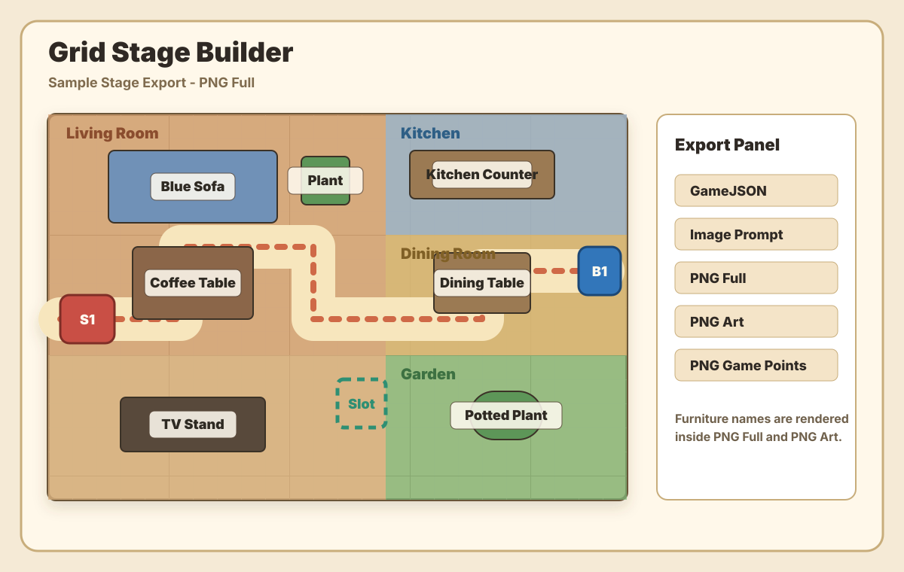

# Grid Stage Builder

A browser-based map and stage editor for tile-based games.

Grid Stage Builder helps you design one master map, split it into playable stages, place gameplay markers, draw enemy paths, preview the result, and export data for production use.

It started as a house-map workflow for a mobile tower defense game, but the tool is intentionally generic enough for any block-grid stage design.



## Try Online

Use the editor in your browser:

<https://paiiap.github.io/grid-stage-builder/>

No install step is required.

## What It Does

- Build a full master map on a fixed 48 x 48 grid.
- Divide the master map into multiple named stages.
- Place room areas, furniture/object blocks, doors, walls, build zones, and terrain.
- Add stage gameplay markers such as spawn, base, build slot, waypoint, and choke point.
- Draw multiple paths per stage and connect each path to its spawn and base.
- Expand path areas by painting extra walkable blocks.
- Preview a selected stage before export.
- Export project JSON, stage JSON, image prompts, and PNG previews.
- Show validation errors with stage context, path context, and blocking object references.
- Switch between classic, dark, and pastel UI themes.

## Scale

1 tile = 48x48 px in the editor and exports, which maps to roughly **60 cm** in the real world. This scale was picked by checking it against common furniture sizes: a 4x1-tile kitchen counter comes out to 240x60 cm (matching the standard 60 cm counter depth), and a 3x2-tile sofa or tub both land at 180x120 cm, close to real dimensions.

### Real-scale view

The grid stays the gameplay truth (blocking, paths, stages). On top of it the **Real scale** layer
(SHOW/HIDE panel) draws what the room really looks like, using `real-scale.js`:

- walls are 30 cm bars on the tile centre lines, joined at corners and cut around doors;
- doors open at their real width with a swing arc of the same radius;
- furniture is drawn at its real size inside its tile footprint (the dashed outline is the
  footprint that blocks paths); the selected object shows `W x D x H cm`;
- a scale bar (1 m / 2 m) sits in the bottom-left corner.

All real-scale data is optional, so older projects load unchanged:

| Field | Where | Meaning |
| --- | --- | --- |
| `map.scale` | map | `tile_cm` (60), `wall_thickness_cm` (30), `wall_height_cm` (240), `floor_levels_cm` per terrain |
| `map.render_hints` | map | free-form hints for renderers, e.g. `garden_scatter` counts for the Blender build |
| `size_cm: {w, d, h, align}` | object | real size; `w` runs along the front edge (from `facing`), `d` front to back; a missing `w`/`d` fills the footprint; `align` `back` / `front` / `center` |
| `width_cm` | door | real opening width measured from the hinge side (narrower leaves a wall filler, wider cuts into the next wall tile) |
| `door_type: "folding"` | door | bi-fold glass doors |
| `sill_cm`, `head_cm` | window | window height above the floor |
| `style` | object | renderer hints, e.g. `{color}`, `{curtain_rail}`, `{upper_cabinets}`, `{hood}`, tree `{kind, canopy_cm, leaf_color}`, `{render_as: "wall"}` |
| `thin_walls[]` | map | partitions off the tile centre lines: `axis`, `at`, `from`, `to` (tile units, fractions allowed), `thickness_cm`, `openings[{from, to, type}]` |
| `decor_paths[]` | map | landscape lines: `kind` `paved` (with `width_cm`), `stepping_stones` (with `spacing_cm`) or `fence` (with `gates`), `points[{x, y}]` |

Default real sizes per category live in `REAL_SIZES_CM` in `real-scale.js`; edit a placed
object's real size in **Object Details**.

The **Lines** tool (`L`) draws `thin_walls` and `decor_paths` with points snapped to 15 cm:
drag a partition wall (locks to horizontal or vertical), or click points for a paved path,
stepping stones or a fence and finish with double-click or Enter (Esc cancels). Click a line to
select it; the panel can add a sliding door to a partition, a gate to a fence, change the
width / thickness, or delete it. Hold Shift to start a new line on top of an existing one.
A selected line shows its points: drag a point to move it (a partition end slides along the
wall), double-click a path or fence to add a point, double-click a point to remove it.
Lines do not block paths.

## Main Workflow

1. Open the editor in a browser.
2. Use `Maps` mode to draw the master map.
3. Add rooms and place map objects.
4. Switch to `Stage` mode.
5. Create a stage frame over the area that should become a playable level.
6. Add spawn and base markers.
7. Create one or more paths and assign the matching spawn/base pair.
8. Use path expansion for wider walking areas.
9. Check validation and stage preview.
10. Export the stage data or the full project.

## Modes

### Maps

Use this mode to build the reusable master map.

Maps mode handles the house/layout data: rooms, tile properties, walls, build state, furniture blocks, doors, and object placement.

### Stage

Use this mode to design playable levels from the master map.

Stage mode handles level-specific data: stage bounds, spawn/base markers, paths, path width, path expansion, stage preview, and stage export.

## Project Save / Load

The top toolbar uses project language because a saved project includes both map data and stage data.

- `New Project` creates a fresh editor document.
- `Save Project` exports the full project JSON.
- `Load Project` imports a previously saved project JSON.
- `Load Sample` restores the built-in sample layout.

The editor also saves the current project in browser `localStorage` while you work.

The sample project is also available as `examples/sample-project.json`.

## Stage Export

Each stage can be exported separately.

Available stage exports:

- `GameJSON` for game/runtime data.
- `Image Prompt` for image-generation prompt text.
- `PNG Full` for the complete stage image with art, grid, game points, path, and furniture names.
- `PNG Art` for room color, terrain, structure, furniture, furniture names, and grid.
- `PNG Game Points` for path, spawn/base/build slots, and grid.

Stage JSON is cropped to the stage area and includes only the relevant tiles, rooms, objects, markers, and paths used by that stage.

## Validation

The validation panel catches common stage-design issues before export.

Examples:

- path missing spawn or base
- path does not start on its assigned spawn
- path does not end on its assigned base
- path goes through a blocked tile
- path collides with a blocking object
- stage area leaves the master map

When a path hits furniture or another blocking object, the message includes the stage and object, so it is easier to fix the correct level.

## Run Locally

No build step is required.

Open `index.html` directly in a browser.

## Test

```bash
npm test
npm run check
```

The tests cover core map/stage behavior, export rules, validation rules, and static UI wiring.

## Files

- `index.html` - application shell and controls
- `styles.css` - layout, themes, and visual styling
- `app.js` - editor interaction, rendering, persistence, and UI state
- `core.js` - map data model, stage export, path rasterization, and validation
- `tests/` - Node tests for core behavior and UI structure

## Status

This is an early production-tool prototype.

The current focus is making stage design fast, readable, and exportable for a tile-based game pipeline.

Detailed map-builder status is tracked in [`docs/map-builder-status.md`](docs/map-builder-status.md).
